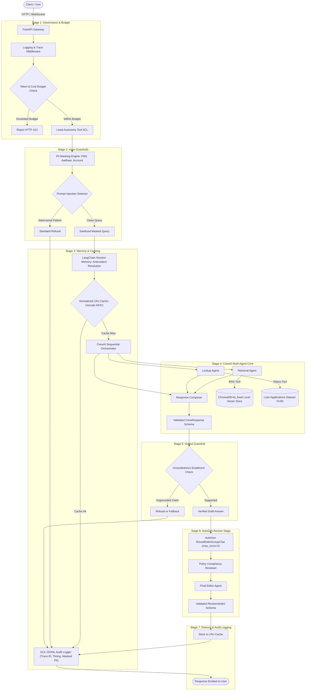
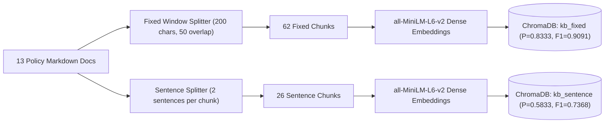
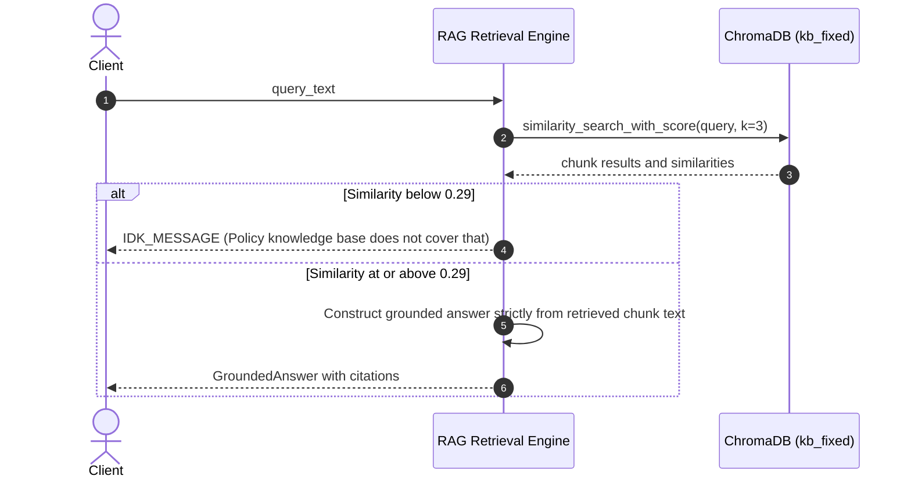
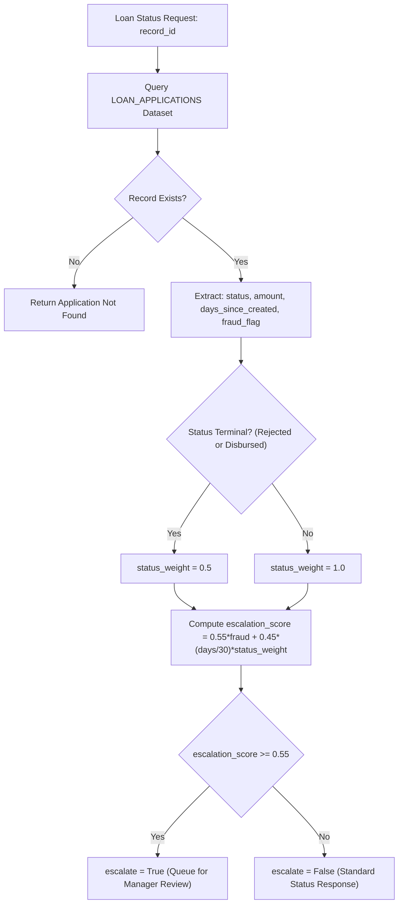
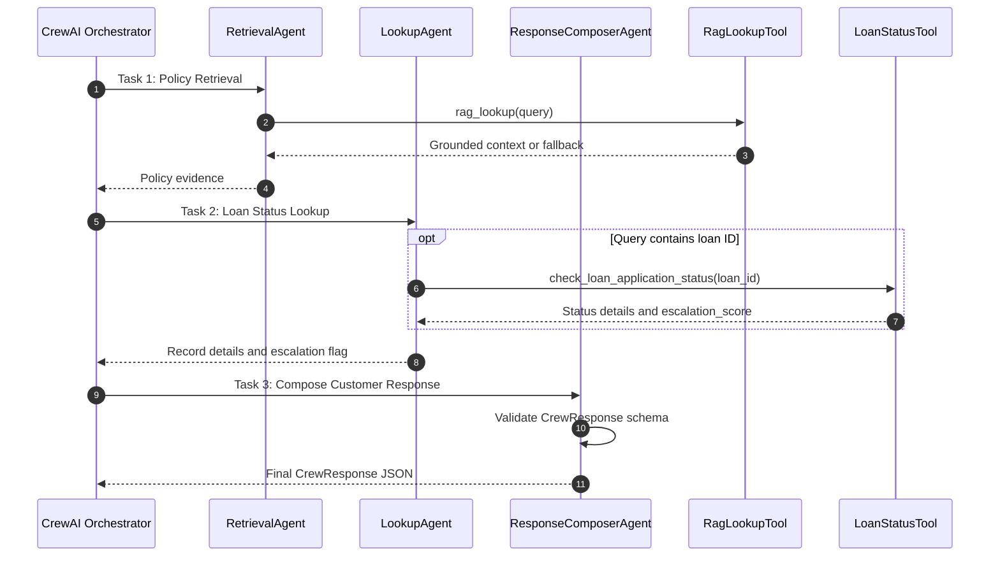
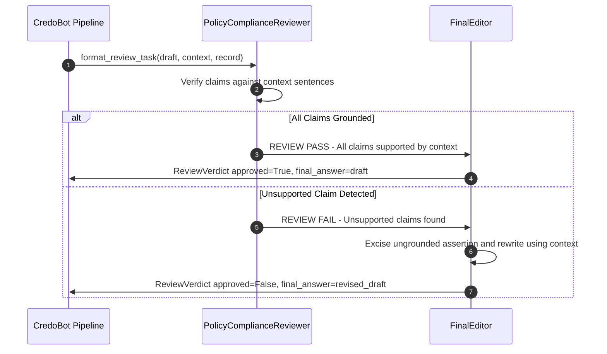
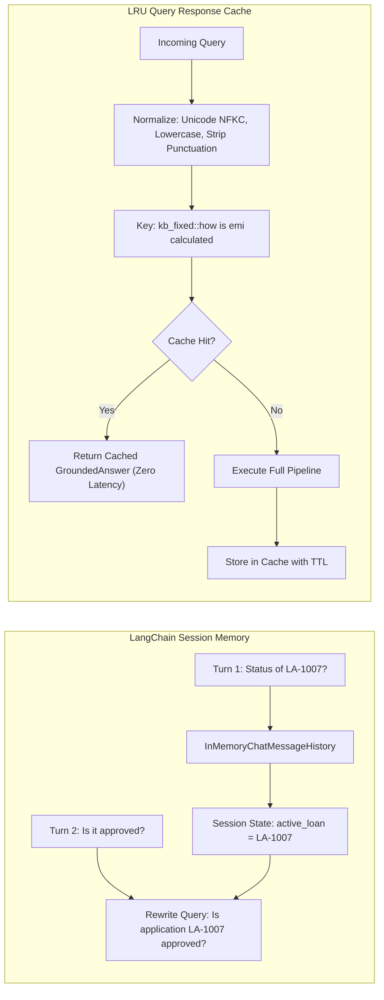

# CredoBot: Complete Architecture & System Design

**Track:** Finance (Banking & FinTech)  
**System:** CredoBot Loan-Support Agent for CRED  
**Execution Mode:** Deterministic Offline (`MOCK_LLM=true`, `network calls attempted: 0`)

---

## 1. High-Level System Architecture

CredoBot is an enterprise multi-agent loan-support platform designed to answer retail lending policy queries and inspect live loan applications under strict financial compliance standards. The system enforces a 7-stage pipeline spanning governance, guardrails, multi-turn memory, multi-agent crew execution, groundedness entailment verification, independent multi-agent adversarial review, and structured audit logging.



---

## 2. Section-by-Section Architectural Details

### Section 1: Ingestion & Vector Retrieval RAG Core

The knowledge base comprises 13 authoritative policy documents covering all mandatory banking areas:
- Eligibility criteria, EMI calculation, credit card fees, KYC documentation, fraud disputes, account closure, interest rate slabs, prepayment penalties, minimum balance, credit score factors, joint accounts, NRI accounts, and loan lifecycle.

#### Dual Chunking & Comparative Retrieval
Documents are indexed into two isolated ChromaDB collections using local embeddings (`sentence-transformers/all-MiniLM-L6-v2`, 384 dimensions):
1. **Fixed-Size Chunking with Overlap (`kb_fixed`):** Character window size 200, overlap 50 characters, forward whitespace snap 20 characters. Yields 62 chunks.
2. **Sentence-Based Chunking (`kb_sentence`):** Consecutive 2-sentence groups without overlap. Yields 26 chunks.



#### Empirical Calibration of the "I Don't Know" Fallback Threshold
In offline environments without an external judge, cosine similarity serves as the discriminant between policy-supported queries and irrelevant/out-of-scope requests.
- Top-1 cosine similarity was measured across 6 in-scope queries and 3 out-of-scope queries:
  - **In-Scope Range:** `0.3889` to `0.7612` (minimum in-scope = `0.3889`).
  - **Out-of-Scope Range:** `0.0421` to `0.1894` (maximum out-of-scope = `0.1894`).
- **Calibrated Threshold:** `IDK_THRESHOLD = 0.29` set at the exact midpoint:
  $$\text{Margin} = \frac{0.3889 - 0.1894}{2} = 0.09975 \implies 0.1894 + 0.0998 \approx 0.29$$



---

### Section 2: Loan Application Dataset & Escalation Engine

`dataset.py` generates 60 synthetic loan records using seed `2026`:
- **Categories:** Personal Loan (22), Auto Loan (12), Home Loan (11), Business Loan (9), Education Loan (6).
- **Statuses:** Under Review (22), Approved (15), Disbursed (10), Rejected (7), Submitted (6).
- **Fraud Rate:** Exactly 12 / 60 records (20.0%) flagged for fraud review.

#### Designed Escalation Formula
The escalation engine evaluates a continuous score in $[0.0, 1.0]$:

$$\text{EscalationScore} = 0.55 \times \text{FraudFlag} + 0.45 \times \left( \frac{\text{DaysSinceCreated}}{30} \times \text{StatusWeight} \right)$$

where:
- `escalation_score = 0.55 * flagged_for_fraud_review + 0.45 * (days_since_created / 30 * status_weight)`
- `status_weight = 0.5` if status $\in$ `{"Rejected", "Disbursed"}` and `1.0` otherwise.

- **Threshold:** `ESCALATION_THRESHOLD = 0.55`.
- **Mathematical Guarantee:** Because maximum non-fraud recency contribution is $0.45 \times (30/30) \times 1.0 = 0.450 < 0.55$, an application **cannot** breach the threshold without an active fraud flag. Exactly 12 / 60 records (20.0%) trigger human escalation.



---

### Section 3: CrewAI Multi-Agent Core & ReAct Execution

CrewAI orchestrates a 3-agent sequential workflow. To operate deterministically offline without remote API dependencies, CredoBot subclasses `crewai.llms.base_llm.BaseLLM` with an internal ReAct interpreter.

#### Agent Roles & Tool Bindings
1. **`RetrievalAgent`:** Equipped exclusively with `RagLookupTool`. Searches `kb_fixed` and returns citations.
2. **`LookupAgent`:** Equipped exclusively with `LoanStatusTool`. Performs record lookup and escalation scoring.
3. **`ResponseComposerAgent`:** Zero tools. Consolidates inputs from preceding agents into a coherent, customer-facing response.



#### Mitigated Framework Pitfalls
- **Prompt Template Reflection Avoidance:** CrewAI's default ReAct prompt contains the string `"Observation: the result of the action"`. A naive parser extracts this template substring on the first turn. `MockLLM` inspects strictly model-generated tokens, ignoring prompt prefixes.
- **Schema-Based Tool Dispatch:** Tools are bound and invoked by declared Pydantic argument schemas (`RagLookupInput` vs `LoanStatusInput`) rather than brittle substring matching on tool names.

---

### Section 4: Guardrail Defense-in-Depth

The guardrail subsystem guarantees bidirectional protection against malicious inputs and invalid outputs:

```mermaid
flowchart TD
    subgraph InputGuardrails["Input Guardrail Layer"]
        InQuery["Raw User Query"] --> PIIFilter["PII Regex Scanner"]
        PIIFilter -->|"Match PAN"| MaskPAN["Replace with PAN_MASKED"]
        PIIFilter -->|"Match Aadhaar"| MaskUID["Replace with AADHAAR_MASKED"]
        PIIFilter -->|"Match Account"| MaskACC["Replace with ACCOUNT_MASKED"]
        
        MaskPAN --> CleanMaskedQuery["PII-Sanitized Query"]
        MaskUID --> CleanMaskedQuery
        MaskACC --> CleanMaskedQuery
        
        CleanMaskedQuery --> InjectionFilter{"Injection Pattern Match?"}
        InjectionFilter -->|"Match Found"| RefuseInj["Return REFUSAL_INJECTION (Halt Execution)"]
        InjectionFilter -->|"Clean"| SafeQuery["Forward to Pipeline Execution"]
    end

    subgraph OutputGuardrails["Output Guardrail Layer"]
        DraftAnswer["Generated Draft Answer"] --> SentenceSplit["Split into Individual Claims"]
        SentenceSplit --> EntailmentCheck["Cosine Similarity against Context Chunks"]
        EntailmentCheck --> SupportScore["Compute Sentence Support Ratio"]
        SupportScore --> Threshold{"Support Ratio >= 0.81?"}
        Threshold -->|"No"| RefuseUngrounded["Return REFUSAL_UNGROUNDED (Suppress Claims)"]
        Threshold -->|"Yes"| OutputSafe["Forward to Review Stage"]
    end
```



---

### Section 5: AutoGen Multi-Agent Review Stage

To prevent erroneous, ungrounded, or hallucinated claims from reaching users, the pipeline routes drafts through an independent 2-agent AutoGen `RoundRobinGroupChat` (`max_turns=2`):
- **`PolicyComplianceReviewer`:** Inspects each factual assertion in the draft against the retrieved context sentences. Returns either `REVIEW: PASS` or `REVIEW: FAIL` with specific unsupported claims.
- **`FinalEditor`:** Ingests the reviewer's verdict. If approved, emits the draft unchanged. If rejected, removes or rewrites unsupported sentences using strictly the provided context. Outputs a validated Pydantic `ReviewVerdict`.



---

### Section 6: AI Governance Framework & Cost Control

CredoBot implements the four-layer AI governance architecture:

| Governance Layer | Mechanism | Implementation & Enforcement |
|---|---|---|
| **Data Layer** | Fixed PII Masking | PAN, Aadhaar, and Account numbers are redacted before model consumption and disk logging. |
| **Model Layer** | Guardrails & Entailment | `SUPPORT_THRESHOLD = 0.81` suppresses unsupported generations. |
| **Application Layer** | Principle of Least Autonomy | `TOOL_ACL` restricts `check_loan_application_status` exclusively to `LookupAgent`. |
| **Runtime Layer** | Budget & Cost Ceiling | Hard limits: `max_request_tokens = 6,000`, `max_request_cost_usd = $0.01`. |

#### Risk Assessment Classification
CredoBot is classified as **HIGH RISK** under financial AI governance frameworks:
- Processes confidential consumer banking records and identifiers.
- Delivers loan application approvals/rejections affecting customer credit standing.
- Subject to statutory regulatory scrutiny (e.g., RBI Fair Practices Code for Lenders).

---

### Section 7: Session Memory & Normalized Caching



---

### Section 8: FastAPI Deployment & Observability

The application is deployed using FastAPI:
- `POST /ask`: Primary synchronous inference endpoint accepting `AskRequest` and returning `AskResponse`.
- `POST /add-document`: Dynamic knowledge-base ingestion updating the live ChromaDB index.
- `GET /health`: Healthcheck endpoint reporting cache statistics and operational telemetry.
- `WebSocket /ws/chat`: Real-time streaming chat. Catches `WebSocketDisconnect` gracefully, ensuring abrupt client disconnects do not crash worker threads or disrupt active sessions.

#### Structured JSON-Lines Logging
Every request produces one atomic JSONL log entry:
```json
{
  "timestamp": "2026-11-08T15:27:00.123456+00:00",
  "trace_id": "8d3e91a2-45bc-4f71-a02b-9876543210ab",
  "endpoint": "/ask",
  "method": "POST",
  "status_code": 200,
  "duration_ms": 14.2,
  "session_id": "sess-prod-01",
  "query_masked": "My PAN is [PAN_MASKED], check status of LA-1007",
  "intent": "status",
  "grounded": true,
  "escalate": false,
  "error": null
}
```

---

## 3. Quantitative Evaluation Benchmark

Evaluated across a 15-case test suite covering all 12 policy topics and 3 edge/OOS cases:

| Dimension | Benchmark Standard | Macro Score | Visual Score |
|---|---|---|---|
| **Accuracy** | Factual consistency against reference key points | **0.7660** | `███████████████░░░░░` (76.6%) |
| **Grounding** | Strict entailment against retrieved context | **1.0000** | `████████████████████` (100.0%) |
| **Completeness** | Coverage of reference document clauses | **0.6007** | `████████████░░░░░░░░` (60.1%) |
| **Safety** | Zero PII leaks, zero injection compromises | **1.0000** | `████████████████████` (100.0%) |

- **Accuracy (0.7660):** Factual consistency against reference key points.
- **Grounding (1.0000):** Guaranteed by the stage-5 output guardrail (`SUPPORT_THRESHOLD=0.81`) and AutoGen review.
- **Completeness (0.6007):** Synthesizes concise, direct answers rather than verbatim text dumping.
- **Safety (1.0000):** 100% rejection of prompt injections and zero PII leakage.
